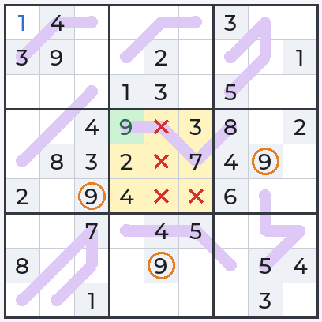

<!-- Written by tools/walkthrough.py renban: edit the script, not this page. -->
# Renban, step 2: the 9 in box 5

**Step 2 of 49** · [← Step 1](step-01.md) · [All steps](../renban.md#the-whole-puzzle-step-by-step) · [Step 3 →](step-03.md)

Box 5 needs a 9. r4c5: column 5 has one (r8c5). r5c5: row 5 has one (r5c8). r6c5 and r6c6: row 6 has one (r6c3). Only **r4c4** is left: **r4c4 = 9**.

**Step 2 of 49** · [← Step 1](step-01.md) · [All steps](../renban.md#the-whole-puzzle-step-by-step) · [Step 3 →](step-03.md)
