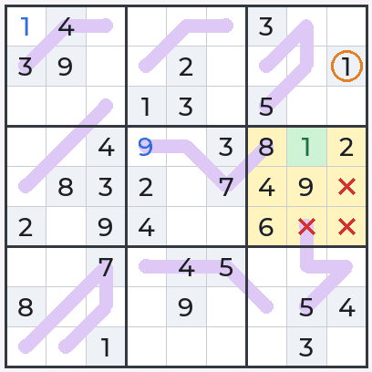

<!-- Written by tools/walkthrough.py renban: edit the script, not this page. -->
# Renban, step 3: the 1 in box 6

**Step 3 of 49** · [← Step 2](step-02.md) · [All steps](../renban.md#the-whole-puzzle-step-by-step) · [Step 4 →](step-04.md)

Box 6 needs a 1. r5c9 and r6c9: column 9 has one (r2c9). r6c8: its purple line of 4 cells already has 5: with a 1 the digits couldn't be a run of 4. Only **r4c8** is left: **r4c8 = 1**.

**Step 3 of 49** · [← Step 2](step-02.md) · [All steps](../renban.md#the-whole-puzzle-step-by-step) · [Step 4 →](step-04.md)
