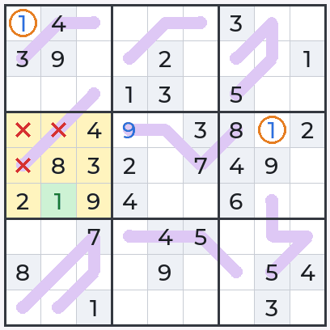

<!-- Written by tools/walkthrough.py renban: edit the script, not this page. -->
# Renban, step 4: the 1 in box 4

**Step 4 of 49** · [← Step 3](step-03.md) · [All steps](../renban.md#the-whole-puzzle-step-by-step) · [Step 5 →](step-05.md)

Box 4 needs a 1. r4c1 and r4c2: row 4 has one (r4c8). r5c1: column 1 has one (r1c1). Only **r6c2** is left: **r6c2 = 1**.

**Step 4 of 49** · [← Step 3](step-03.md) · [All steps](../renban.md#the-whole-puzzle-step-by-step) · [Step 5 →](step-05.md)
