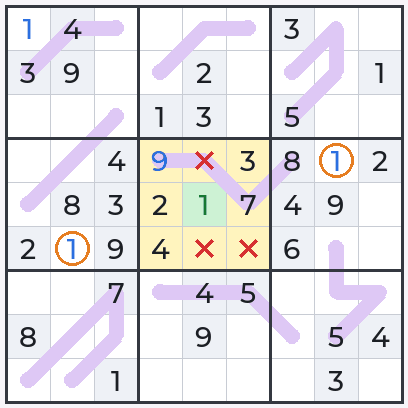

<!-- Written by tools/walkthrough.py renban: edit the script, not this page. -->
# Renban, step 5: the 1 in box 5

**Step 5 of 49** · [← Step 4](step-04.md) · [All steps](../renban.md#the-whole-puzzle-step-by-step) · [Step 6 →](step-06.md)

Box 5 needs a 1. r4c5: row 4 has one (r4c8). r6c5 and r6c6: row 6 has one (r6c2). Only **r5c5** is left: **r5c5 = 1**.

**Step 5 of 49** · [← Step 4](step-04.md) · [All steps](../renban.md#the-whole-puzzle-step-by-step) · [Step 6 →](step-06.md)
