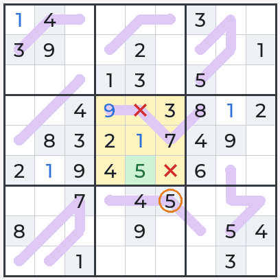

<!-- Written by tools/walkthrough.py renban: edit the script, not this page. -->
# Renban, step 6: the 5 in box 5

**Step 6 of 49** · [← Step 5](step-05.md) · [All steps](../renban.md#the-whole-puzzle-step-by-step) · [Step 7 →](step-07.md)

Box 5 needs a 5. r6c6: column 6 has one (r7c6). r4c5: its purple line of 4 cells already has 7, 8 and 9: with a 5 the digits couldn't be a run of 4. Only **r6c5** is left: **r6c5 = 5**.

**Step 6 of 49** · [← Step 5](step-05.md) · [All steps](../renban.md#the-whole-puzzle-step-by-step) · [Step 7 →](step-07.md)
