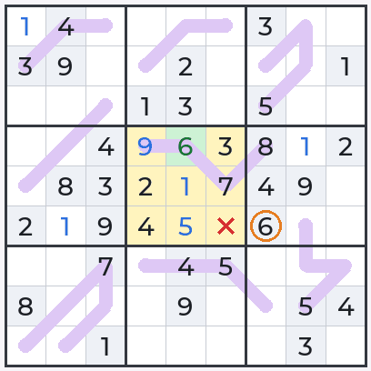

<!-- Written by tools/walkthrough.py renban: edit the script, not this page. -->
# Renban, step 7: the 6 in box 5

**Step 7 of 49** · [← Step 6](step-06.md) · [All steps](../renban.md#the-whole-puzzle-step-by-step) · [Step 8 →](step-08.md)

Box 5 needs a 6. r6c6: row 6 has one (r6c7). Only **r4c5** is left: **r4c5 = 6**.

**Step 7 of 49** · [← Step 6](step-06.md) · [All steps](../renban.md#the-whole-puzzle-step-by-step) · [Step 8 →](step-08.md)
