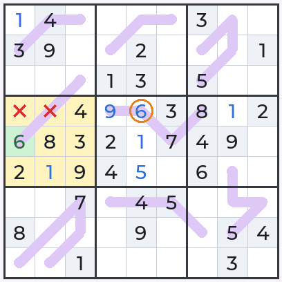

<!-- Written by tools/walkthrough.py renban: edit the script, not this page. -->
# Renban, step 8: the 6 in box 4

**Step 8 of 49** · [← Step 7](step-07.md) · [All steps](../renban.md#the-whole-puzzle-step-by-step) · [Step 9 →](step-09.md)

Box 4 needs a 6. r4c1 and r4c2: row 4 has one (r4c5). Only **r5c1** is left: **r5c1 = 6**.

**Step 8 of 49** · [← Step 7](step-07.md) · [All steps](../renban.md#the-whole-puzzle-step-by-step) · [Step 9 →](step-09.md)
