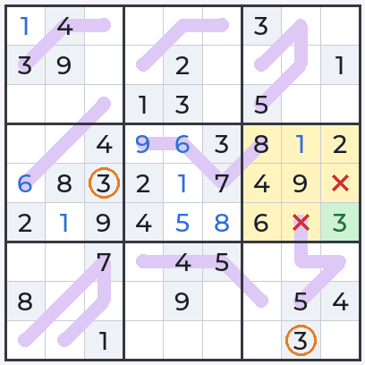

<!-- Written by tools/walkthrough.py renban: edit the script, not this page. -->
# Renban, step 10: the 3 in box 6

**Step 10 of 49** · [← Step 9](step-09.md) · [All steps](../renban.md#the-whole-puzzle-step-by-step) · [Step 11 →](step-11.md)

Box 6 needs a 3. r5c9: row 5 has one (r5c3). r6c8: column 8 has one (r9c8). Only **r6c9** is left: **r6c9 = 3**.

**Step 10 of 49** · [← Step 9](step-09.md) · [All steps](../renban.md#the-whole-puzzle-step-by-step) · [Step 11 →](step-11.md)
