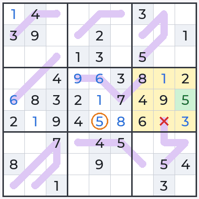

<!-- Written by tools/walkthrough.py renban: edit the script, not this page. -->
# Renban, step 11: the 5 in box 6

**Step 11 of 49** · [← Step 10](step-10.md) · [All steps](../renban.md#the-whole-puzzle-step-by-step) · [Step 12 →](step-12.md)

Box 6 needs a 5. r6c8: row 6 has one (r6c5). Only **r5c9** is left: **r5c9 = 5**.

**Step 11 of 49** · [← Step 10](step-10.md) · [All steps](../renban.md#the-whole-puzzle-step-by-step) · [Step 12 →](step-12.md)
