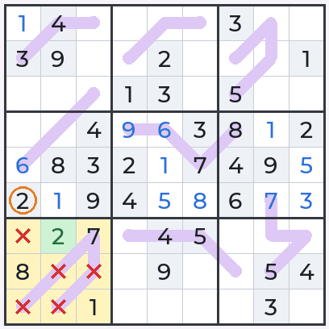

<!-- Written by tools/walkthrough.py renban: edit the script, not this page. -->
# Renban, step 13: the 2 in box 7

**Step 13 of 49** · [← Step 12](step-12.md) · [All steps](../renban.md#the-whole-puzzle-step-by-step) · [Step 14 →](step-14.md)

Box 7 needs a 2. r7c1 and r9c1: column 1 has one (r6c1). r8c2, r8c3 and r9c2: its purple line of 5 cells already has 7: with a 2 the digits couldn't be a run of 5. Only **r7c2** is left: **r7c2 = 2**.

**Step 13 of 49** · [← Step 12](step-12.md) · [All steps](../renban.md#the-whole-puzzle-step-by-step) · [Step 14 →](step-14.md)
