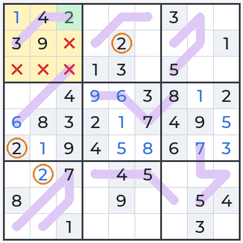

<!-- Written by tools/walkthrough.py renban: edit the script, not this page. -->
# Renban, step 14: the 2 in box 1

**Step 14 of 49** · [← Step 13](step-13.md) · [All steps](../renban.md#the-whole-puzzle-step-by-step) · [Step 15 →](step-15.md)

Box 1 needs a 2. r2c3: row 2 has one (r2c5). r3c1: column 1 has one (r6c1). r3c2: column 2 has one (r7c2). r3c3: its purple line of 3 cells already has 6: with a 2 the digits couldn't be a run of 3. Only **r1c3** is left: **r1c3 = 2**.

**Step 14 of 49** · [← Step 13](step-13.md) · [All steps](../renban.md#the-whole-puzzle-step-by-step) · [Step 15 →](step-15.md)
