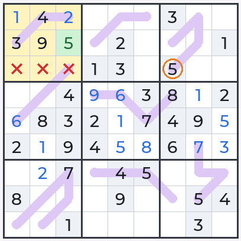

<!-- Written by tools/walkthrough.py renban: edit the script, not this page. -->
# Renban, step 15: the 5 in box 1

**Step 15 of 49** · [← Step 14](step-14.md) · [All steps](../renban.md#the-whole-puzzle-step-by-step) · [Step 16 →](step-16.md)

Box 1 needs a 5. r3c1, r3c2 and r3c3: row 3 has one (r3c7). Only **r2c3** is left: **r2c3 = 5**.

**Step 15 of 49** · [← Step 14](step-14.md) · [All steps](../renban.md#the-whole-puzzle-step-by-step) · [Step 16 →](step-16.md)
