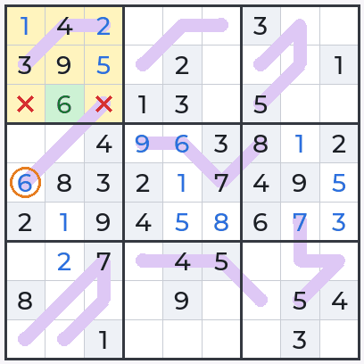

<!-- Written by tools/walkthrough.py renban: edit the script, not this page. -->
# Renban, step 16: the 6 in box 1

**Step 16 of 49** · [← Step 15](step-15.md) · [All steps](../renban.md#the-whole-puzzle-step-by-step) · [Step 17 →](step-17.md)

Box 1 needs a 6. r3c1: column 1 has one (r5c1). r3c3: its purple line already has a 6. Only **r3c2** is left: **r3c2 = 6**.

**Step 16 of 49** · [← Step 15](step-15.md) · [All steps](../renban.md#the-whole-puzzle-step-by-step) · [Step 17 →](step-17.md)
