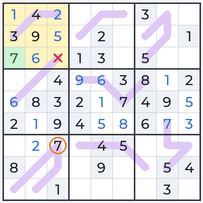

<!-- Written by tools/walkthrough.py renban: edit the script, not this page. -->
# Renban, step 17: the 7 in box 1

**Step 17 of 49** · [← Step 16](step-16.md) · [All steps](../renban.md#the-whole-puzzle-step-by-step) · [Step 18 →](step-18.md)

Box 1 needs a 7. r3c3: column 3 has one (r7c3). Only **r3c1** is left: **r3c1 = 7**.

**Step 17 of 49** · [← Step 16](step-16.md) · [All steps](../renban.md#the-whole-puzzle-step-by-step) · [Step 18 →](step-18.md)
