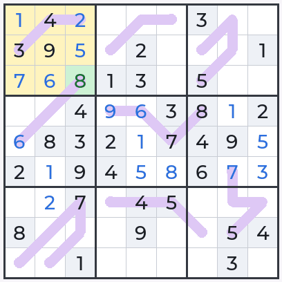

<!-- Written by tools/walkthrough.py renban: edit the script, not this page. -->
# Renban, step 18: the 8 in box 1

**Step 18 of 49** · [← Step 17](step-17.md) · [All steps](../renban.md#the-whole-puzzle-step-by-step) · [Step 19 →](step-19.md)

Box 1 needs an 8, and r3c3 is its last empty cell: **r3c3 = 8**.

**Step 18 of 49** · [← Step 17](step-17.md) · [All steps](../renban.md#the-whole-puzzle-step-by-step) · [Step 19 →](step-19.md)
