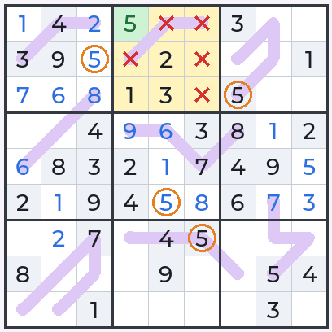

<!-- Written by tools/walkthrough.py renban: edit the script, not this page. -->
# Renban, step 19: the 5 in box 2

**Step 19 of 49** · [← Step 18](step-18.md) · [All steps](../renban.md#the-whole-puzzle-step-by-step) · [Step 20 →](step-20.md)

Box 2 needs a 5. r1c5: column 5 has one (r6c5). r1c6: column 6 has one (r7c6). r2c4 and r2c6: row 2 has one (r2c3). r3c6: row 3 has one (r3c7). Only **r1c4** is left: **r1c4 = 5**.

**Step 19 of 49** · [← Step 18](step-18.md) · [All steps](../renban.md#the-whole-puzzle-step-by-step) · [Step 20 →](step-20.md)
