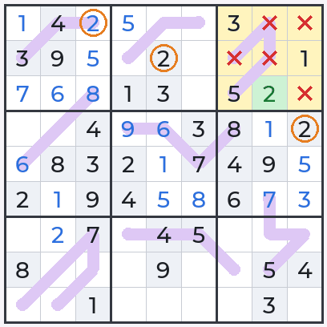

<!-- Written by tools/walkthrough.py renban: edit the script, not this page. -->
# Renban, step 20: the 2 in box 3

**Step 20 of 49** · [← Step 19](step-19.md) · [All steps](../renban.md#the-whole-puzzle-step-by-step) · [Step 21 →](step-21.md)

Box 3 needs a 2. r1c8 and r1c9: row 1 has one (r1c3). r2c7 and r2c8: row 2 has one (r2c5). r3c9: column 9 has one (r4c9). Only **r3c8** is left: **r3c8 = 2**.

**Step 20 of 49** · [← Step 19](step-19.md) · [All steps](../renban.md#the-whole-puzzle-step-by-step) · [Step 21 →](step-21.md)
