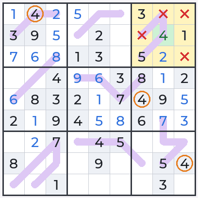

<!-- Written by tools/walkthrough.py renban: edit the script, not this page. -->
# Renban, step 21: the 4 in box 3

**Step 21 of 49** · [← Step 20](step-20.md) · [All steps](../renban.md#the-whole-puzzle-step-by-step) · [Step 22 →](step-22.md)

Box 3 needs a 4. r1c8 and r1c9: row 1 has one (r1c2). r2c7: column 7 has one (r5c7). r3c9: column 9 has one (r8c9). Only **r2c8** is left: **r2c8 = 4**.

**Step 21 of 49** · [← Step 20](step-20.md) · [All steps](../renban.md#the-whole-puzzle-step-by-step) · [Step 22 →](step-22.md)
