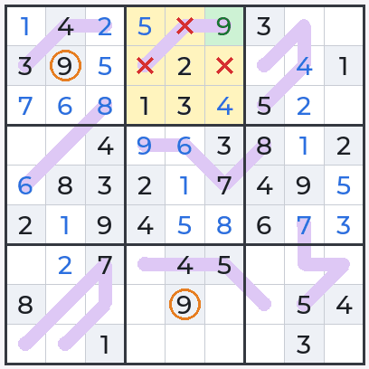

<!-- Written by tools/walkthrough.py renban: edit the script, not this page. -->
# Renban, step 23: the 9 in box 2

**Step 23 of 49** · [← Step 22](step-22.md) · [All steps](../renban.md#the-whole-puzzle-step-by-step) · [Step 24 →](step-24.md)

Box 2 needs a 9. r1c5: column 5 has one (r8c5). r2c4 and r2c6: row 2 has one (r2c2). Only **r1c6** is left: **r1c6 = 9**.

**Step 23 of 49** · [← Step 22](step-22.md) · [All steps](../renban.md#the-whole-puzzle-step-by-step) · [Step 24 →](step-24.md)
