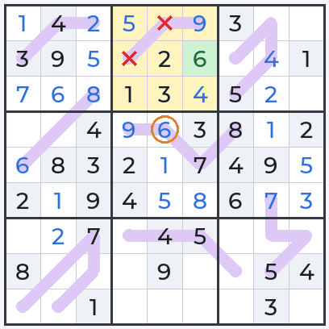

<!-- Written by tools/walkthrough.py renban: edit the script, not this page. -->
# Renban, step 24: the 6 in box 2

**Step 24 of 49** · [← Step 23](step-23.md) · [All steps](../renban.md#the-whole-puzzle-step-by-step) · [Step 25 →](step-25.md)

Box 2 needs a 6. r1c5: column 5 has one (r4c5). r2c4: its purple line of 3 cells already has 9: with a 6 the digits couldn't be a run of 3. Only **r2c6** is left: **r2c6 = 6**.

**Step 24 of 49** · [← Step 23](step-23.md) · [All steps](../renban.md#the-whole-puzzle-step-by-step) · [Step 25 →](step-25.md)
