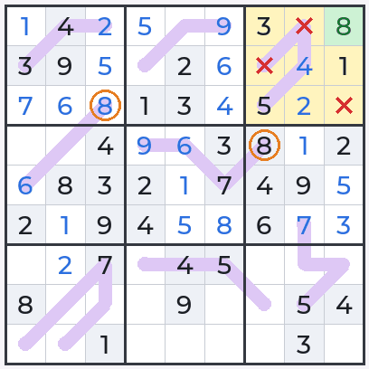

<!-- Written by tools/walkthrough.py renban: edit the script, not this page. -->
# Renban, step 25: the 8 in box 3

**Step 25 of 49** · [← Step 24](step-24.md) · [All steps](../renban.md#the-whole-puzzle-step-by-step) · [Step 26 →](step-26.md)

Box 3 needs an 8. r2c7: column 7 has one (r4c7). r3c9: row 3 has one (r3c3). r1c8: its purple line of 4 cells already has 4 and 5: with an 8 the digits couldn't be a run of 4. Only **r1c9** is left: **r1c9 = 8**.

**Step 25 of 49** · [← Step 24](step-24.md) · [All steps](../renban.md#the-whole-puzzle-step-by-step) · [Step 26 →](step-26.md)
