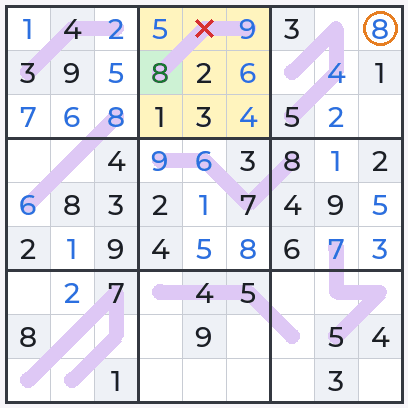

<!-- Written by tools/walkthrough.py renban: edit the script, not this page. -->
# Renban, step 26: the 8 in box 2

**Step 26 of 49** · [← Step 25](step-25.md) · [All steps](../renban.md#the-whole-puzzle-step-by-step) · [Step 27 →](step-27.md)

Box 2 needs an 8. r1c5: row 1 has one (r1c9). Only **r2c4** is left: **r2c4 = 8**.

**Step 26 of 49** · [← Step 25](step-25.md) · [All steps](../renban.md#the-whole-puzzle-step-by-step) · [Step 27 →](step-27.md)
