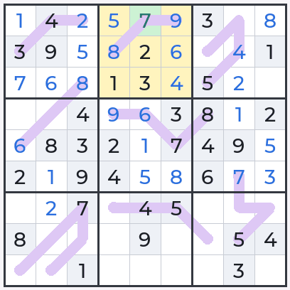

<!-- Written by tools/walkthrough.py renban: edit the script, not this page. -->
# Renban, step 27: the 7 in box 2

**Step 27 of 49** · [← Step 26](step-26.md) · [All steps](../renban.md#the-whole-puzzle-step-by-step) · [Step 28 →](step-28.md)

Box 2 needs a 7, and r1c5 is its last empty cell: **r1c5 = 7**.

**Step 27 of 49** · [← Step 26](step-26.md) · [All steps](../renban.md#the-whole-puzzle-step-by-step) · [Step 28 →](step-28.md)
