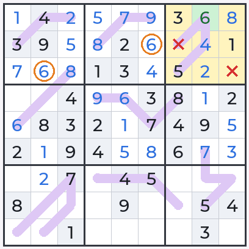

<!-- Written by tools/walkthrough.py renban: edit the script, not this page. -->
# Renban, step 28: the 6 in box 3

**Step 28 of 49** · [← Step 27](step-27.md) · [All steps](../renban.md#the-whole-puzzle-step-by-step) · [Step 29 →](step-29.md)

Box 3 needs a 6. r2c7: row 2 has one (r2c6). r3c9: row 3 has one (r3c2). Only **r1c8** is left: **r1c8 = 6**.

**Step 28 of 49** · [← Step 27](step-27.md) · [All steps](../renban.md#the-whole-puzzle-step-by-step) · [Step 29 →](step-29.md)
