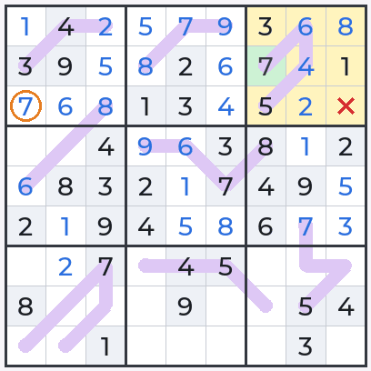

<!-- Written by tools/walkthrough.py renban: edit the script, not this page. -->
# Renban, step 29: the 7 in box 3

**Step 29 of 49** · [← Step 28](step-28.md) · [All steps](../renban.md#the-whole-puzzle-step-by-step) · [Step 30 →](step-30.md)

Box 3 needs a 7. r3c9: row 3 has one (r3c1). Only **r2c7** is left: **r2c7 = 7**.

**Step 29 of 49** · [← Step 28](step-28.md) · [All steps](../renban.md#the-whole-puzzle-step-by-step) · [Step 30 →](step-30.md)
