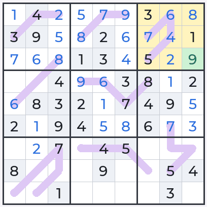

<!-- Written by tools/walkthrough.py renban: edit the script, not this page. -->
# Renban, step 30: the 9 in box 3

**Step 30 of 49** · [← Step 29](step-29.md) · [All steps](../renban.md#the-whole-puzzle-step-by-step) · [Step 31 →](step-31.md)

Box 3 needs a 9, and r3c9 is its last empty cell: **r3c9 = 9**.

**Step 30 of 49** · [← Step 29](step-29.md) · [All steps](../renban.md#the-whole-puzzle-step-by-step) · [Step 31 →](step-31.md)
