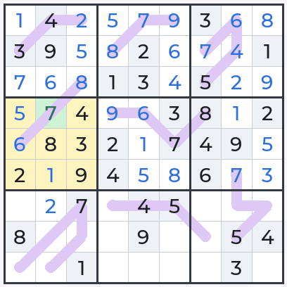

<!-- Written by tools/walkthrough.py renban: edit the script, not this page. -->
# Renban, step 32: the 7 in box 4

**Step 32 of 49** · [← Step 31](step-31.md) · [All steps](../renban.md#the-whole-puzzle-step-by-step) · [Step 33 →](step-33.md)

Box 4 needs a 7, and r4c2 is its last empty cell: **r4c2 = 7**.

**Step 32 of 49** · [← Step 31](step-31.md) · [All steps](../renban.md#the-whole-puzzle-step-by-step) · [Step 33 →](step-33.md)
