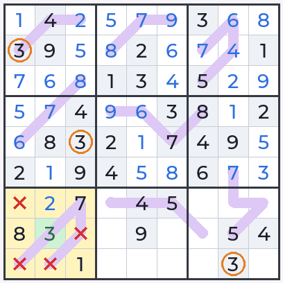

<!-- Written by tools/walkthrough.py renban: edit the script, not this page. -->
# Renban, step 33: the 3 in box 7

**Step 33 of 49** · [← Step 32](step-32.md) · [All steps](../renban.md#the-whole-puzzle-step-by-step) · [Step 34 →](step-34.md)

Box 7 needs a 3. r7c1: column 1 has one (r2c1). r8c3: column 3 has one (r5c3). r9c1 and r9c2: row 9 has one (r9c8). Only **r8c2** is left: **r8c2 = 3**.

**Step 33 of 49** · [← Step 32](step-32.md) · [All steps](../renban.md#the-whole-puzzle-step-by-step) · [Step 34 →](step-34.md)
