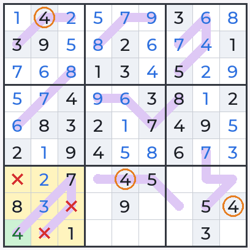

<!-- Written by tools/walkthrough.py renban: edit the script, not this page. -->
# Renban, step 34: the 4 in box 7

**Step 34 of 49** · [← Step 33](step-33.md) · [All steps](../renban.md#the-whole-puzzle-step-by-step) · [Step 35 →](step-35.md)

Box 7 needs a 4. r7c1: row 7 has one (r7c5). r8c3: row 8 has one (r8c9). r9c2: column 2 has one (r1c2). Only **r9c1** is left: **r9c1 = 4**.

**Step 34 of 49** · [← Step 33](step-33.md) · [All steps](../renban.md#the-whole-puzzle-step-by-step) · [Step 35 →](step-35.md)
