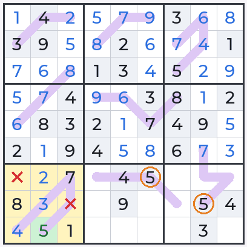

<!-- Written by tools/walkthrough.py renban: edit the script, not this page. -->
# Renban, step 35: the 5 in box 7

**Step 35 of 49** · [← Step 34](step-34.md) · [All steps](../renban.md#the-whole-puzzle-step-by-step) · [Step 36 →](step-36.md)

Box 7 needs a 5. r7c1: row 7 has one (r7c6). r8c3: row 8 has one (r8c8). Only **r9c2** is left: **r9c2 = 5**.

**Step 35 of 49** · [← Step 34](step-34.md) · [All steps](../renban.md#the-whole-puzzle-step-by-step) · [Step 36 →](step-36.md)
