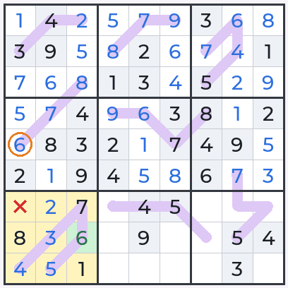

<!-- Written by tools/walkthrough.py renban: edit the script, not this page. -->
# Renban, step 36: the 6 in box 7

**Step 36 of 49** · [← Step 35](step-35.md) · [All steps](../renban.md#the-whole-puzzle-step-by-step) · [Step 37 →](step-37.md)

Box 7 needs a 6. r7c1: column 1 has one (r5c1). Only **r8c3** is left: **r8c3 = 6**.

**Step 36 of 49** · [← Step 35](step-35.md) · [All steps](../renban.md#the-whole-puzzle-step-by-step) · [Step 37 →](step-37.md)
