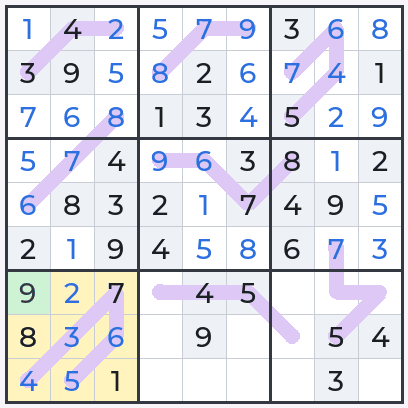

<!-- Written by tools/walkthrough.py renban: edit the script, not this page. -->
# Renban, step 37: the 9 in box 7

**Step 37 of 49** · [← Step 36](step-36.md) · [All steps](../renban.md#the-whole-puzzle-step-by-step) · [Step 38 →](step-38.md)

Box 7 needs a 9, and r7c1 is its last empty cell: **r7c1 = 9**.

**Step 37 of 49** · [← Step 36](step-36.md) · [All steps](../renban.md#the-whole-puzzle-step-by-step) · [Step 38 →](step-38.md)
