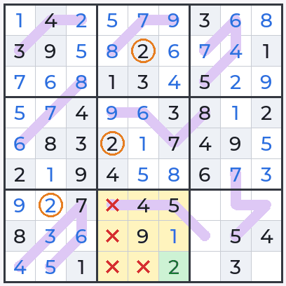

<!-- Written by tools/walkthrough.py renban: edit the script, not this page. -->
# Renban, step 39: the 2 in box 8

**Step 39 of 49** · [← Step 38](step-38.md) · [All steps](../renban.md#the-whole-puzzle-step-by-step) · [Step 40 →](step-40.md)

Box 8 needs a 2. r7c4: row 7 has one (r7c2). r8c4 and r9c4: column 4 has one (r5c4). r9c5: column 5 has one (r2c5). Only **r9c6** is left: **r9c6 = 2**.

**Step 39 of 49** · [← Step 38](step-38.md) · [All steps](../renban.md#the-whole-puzzle-step-by-step) · [Step 40 →](step-40.md)
