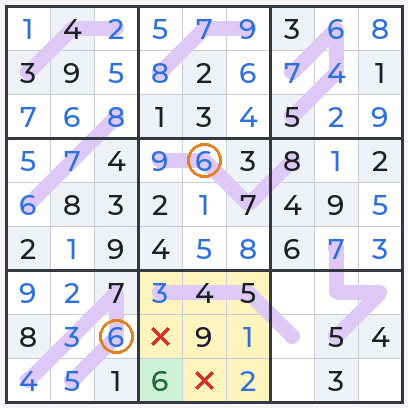

<!-- Written by tools/walkthrough.py renban: edit the script, not this page. -->
# Renban, step 41: the 6 in box 8

**Step 41 of 49** · [← Step 40](step-40.md) · [All steps](../renban.md#the-whole-puzzle-step-by-step) · [Step 42 →](step-42.md)

Box 8 needs a 6. r8c4: row 8 has one (r8c3). r9c5: column 5 has one (r4c5). Only **r9c4** is left: **r9c4 = 6**.

**Step 41 of 49** · [← Step 40](step-40.md) · [All steps](../renban.md#the-whole-puzzle-step-by-step) · [Step 42 →](step-42.md)
