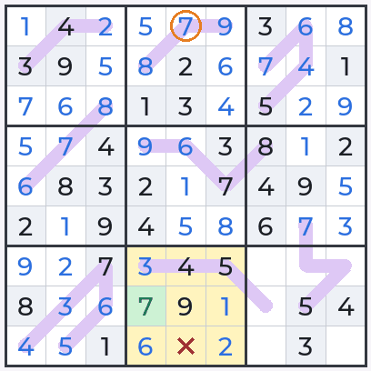

<!-- Written by tools/walkthrough.py renban: edit the script, not this page. -->
# Renban, step 42: the 7 in box 8

**Step 42 of 49** · [← Step 41](step-41.md) · [All steps](../renban.md#the-whole-puzzle-step-by-step) · [Step 43 →](step-43.md)

Box 8 needs a 7. r9c5: column 5 has one (r1c5). Only **r8c4** is left: **r8c4 = 7**.

**Step 42 of 49** · [← Step 41](step-41.md) · [All steps](../renban.md#the-whole-puzzle-step-by-step) · [Step 43 →](step-43.md)
