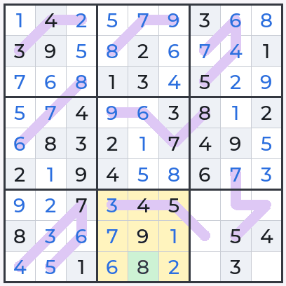

<!-- Written by tools/walkthrough.py renban: edit the script, not this page. -->
# Renban, step 43: the 8 in box 8

**Step 43 of 49** · [← Step 42](step-42.md) · [All steps](../renban.md#the-whole-puzzle-step-by-step) · [Step 44 →](step-44.md)

Box 8 needs an 8, and r9c5 is its last empty cell: **r9c5 = 8**.

**Step 43 of 49** · [← Step 42](step-42.md) · [All steps](../renban.md#the-whole-puzzle-step-by-step) · [Step 44 →](step-44.md)
