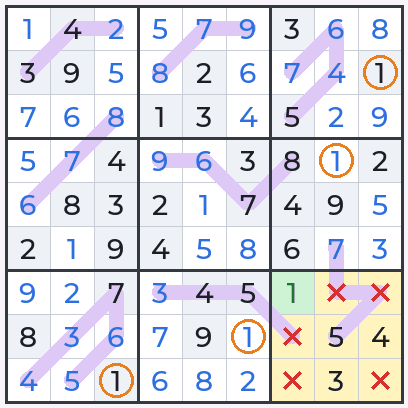

<!-- Written by tools/walkthrough.py renban: edit the script, not this page. -->
# Renban, step 44: the 1 in box 9

**Step 44 of 49** · [← Step 43](step-43.md) · [All steps](../renban.md#the-whole-puzzle-step-by-step) · [Step 45 →](step-45.md)

Box 9 needs a 1. r7c8: column 8 has one (r4c8). r7c9: column 9 has one (r2c9). r8c7: row 8 has one (r8c6). r9c7 and r9c9: row 9 has one (r9c3). Only **r7c7** is left: **r7c7 = 1**.

**Step 44 of 49** · [← Step 43](step-43.md) · [All steps](../renban.md#the-whole-puzzle-step-by-step) · [Step 45 →](step-45.md)
