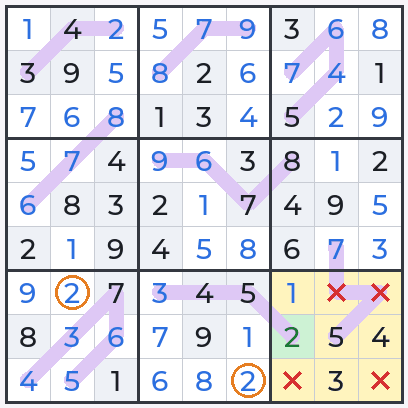

<!-- Written by tools/walkthrough.py renban: edit the script, not this page. -->
# Renban, step 45: the 2 in box 9

**Step 45 of 49** · [← Step 44](step-44.md) · [All steps](../renban.md#the-whole-puzzle-step-by-step) · [Step 46 →](step-46.md)

Box 9 needs a 2. r7c8 and r7c9: row 7 has one (r7c2). r9c7 and r9c9: row 9 has one (r9c6). Only **r8c7** is left: **r8c7 = 2**.

**Step 45 of 49** · [← Step 44](step-44.md) · [All steps](../renban.md#the-whole-puzzle-step-by-step) · [Step 46 →](step-46.md)
