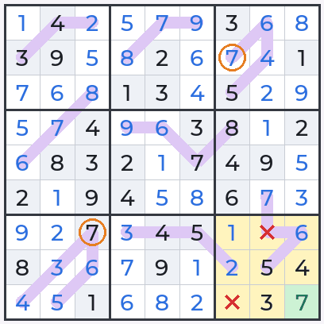

<!-- Written by tools/walkthrough.py renban: edit the script, not this page. -->
# Renban, step 47: the 7 in box 9

**Step 47 of 49** · [← Step 46](step-46.md) · [All steps](../renban.md#the-whole-puzzle-step-by-step) · [Step 48 →](step-48.md)

Box 9 needs a 7. r7c8: row 7 has one (r7c3). r9c7: column 7 has one (r2c7). Only **r9c9** is left: **r9c9 = 7**.

**Step 47 of 49** · [← Step 46](step-46.md) · [All steps](../renban.md#the-whole-puzzle-step-by-step) · [Step 48 →](step-48.md)
