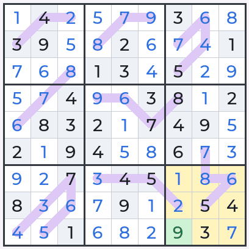

<!-- Written by tools/walkthrough.py renban: edit the script, not this page. -->
# Renban, step 49: the 9 in box 9

**Step 49 of 49** · [← Step 48](step-48.md) · [All steps](../renban.md#the-whole-puzzle-step-by-step) · [All steps](../renban.md#the-whole-puzzle-step-by-step)

Box 9 needs a 9, and r9c7 is its last empty cell: **r9c7 = 9**.

Solved.

**Step 49 of 49** · [← Step 48](step-48.md) · [All steps](../renban.md#the-whole-puzzle-step-by-step) · [All steps](../renban.md#the-whole-puzzle-step-by-step)
