# Rossini

[← All variants](README.md) · [Puzzles](../features-puzzles.md) · [How to play](../how-to-play.md)

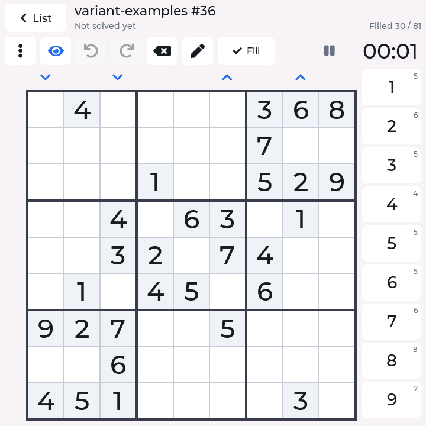

## The rules

[Classic](classic.md) rules, and **arrows** left of the rows and above the columns. An arrow says the **first three digits** from there (the cells of that row or column in the first box) **rise in the direction it points**: an arrow pointing into the grid means they rise away from the edge (2, 4, 7), one pointing out that they fall (8, 5, 1). A row or column **with no arrow** has first three digits that **neither rise nor fall** (like 4, 9, 2): every row and column is clued, the absence of an arrow too.

## On the board

- The arrows are in blue in a margin left of the rows and above the columns, pointing toward the bigger digits.
- Two of the first three digits out of their arrow's order turn red, and so do three that rise or fall where there's no arrow.
- The grader and hints keep each of the first three cells to the digits its arrow leaves room for (a rising first cell is at most 7), and narrow them by the digits already there: "The first three digits of column 6 fall from its arrow's side, so ...".
- **Puzzles → ⋮ → New puzzle → Clues → Rossini**.

## How to solve it

- **A rising three needs room:** the first is 1–7, the second 2–8, the third 3–9; falling, the other way round.
- **One known digit bounds the others:** with a rising arrow and a 6 in the middle, the first is 1–5 and the third 7–9.
- **No arrow is a clue too:** with no arrow and the first two digits 3 and 5, the third is not 6–9 (that would rise).
- **Rows and columns meet in a corner box,** so the top-left box often settles early.

## Worked example

**variant-examples #36**, Rossini Easy (see [Classic](classic.md#worked-example-the-whole-puzzle) for how to import the examples; cells are written r*row*c*column*). The arrows are in the screenshot: column 1's and column 3's point down (rising), column 6's up (falling); no row has one.

**Step 1: r1c6, column 6 (falling).** Row 1 has 3, 4, 6 and 8; column 6 has 5 and 7; box 2 has a 1: that leaves 2 and 9. Column 6's first three fall from the top, so r1c6, the biggest of them, is at least 3. **r1c6 = 9**.

**Step 2: the 9 in row 2.** Row 2 has a 7, and the 9s in r7c1, r1c6 (step 1) and r3c9 rule out r2c1, r2c4 to r2c6, r2c8 and r2c9. That leaves r2c2 and r2c3. r2c3 is the middle of column 3's first three, which rise: it's at most 8. **r2c2 = 9**.

**Step 3: the 1 in box 1.** The 1s in r9c3 and r3c4 rule out r1c3, r2c3 and row 3; r1c2 and r2c2 are filled. That leaves r1c1 and r2c1. r2c1 is the middle of column 1's first three, which rise: it's at least 2. **r1c1 = 1**.

## The whole puzzle, step by step

<!-- walkthrough -->
<!-- Written by tools/walkthrough.py rossini: edit the script, not this part. -->

The whole puzzle, from the start to the last cell: 51 steps, each one a single (one place left for a digit, or one digit left for a cell), taken in the order a box's single comes first, so not quite the order of the worked example above. In each picture, the unit the step looks at is tinted yellow (for a cell with one digit left: its row, column and box), the new digit is on green, the digits that rule cells out have an **orange ring**, and the empty cells they rule out a **red cross**. Givens are on grey, digits from earlier steps in blue.

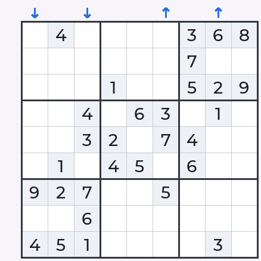

#### Step 1: the 1 in box 1

Box 1 needs a 1. r1c3 and r2c3: column 3 has one (r9c3). r2c2: column 2 has one (r6c2). r3c1, r3c2 and r3c3: row 3 has one (r3c4). r2c1: the first three digits of column 1 rise from the top, so its second cell is 2 to 8. Only **r1c1** is left: **r1c1 = 1**.

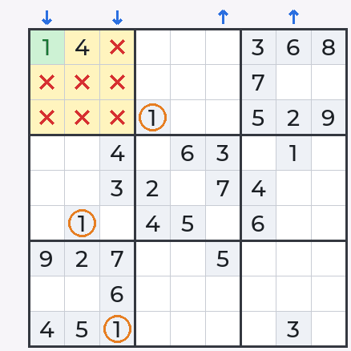

#### Step 2: the 9 in box 1

Box 1 needs a 9. r2c1: column 1 has one (r7c1). r3c1, r3c2 and r3c3: row 3 has one (r3c9). r1c3: the first three digits of column 3 rise from the top, so its first cell is 1 to 7. r2c3: the first three digits of column 3 rise from the top, so its second cell is 2 to 8. Only **r2c2** is left: **r2c2 = 9**.

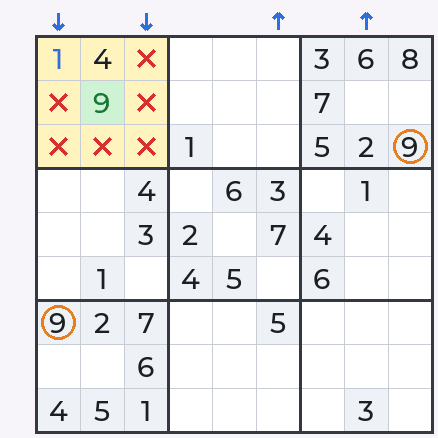

#### Step 3: the 1 in box 3

Box 3 needs a 1. r2c8: column 8 has one (r4c8). Only **r2c9** is left: **r2c9 = 1**.

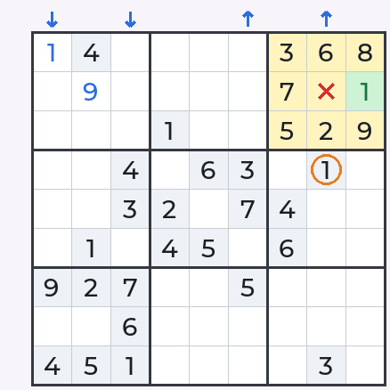

#### Step 4: the 4 in box 3

Box 3 needs a 4, and r2c8 is its last empty cell: **r2c8 = 4**.

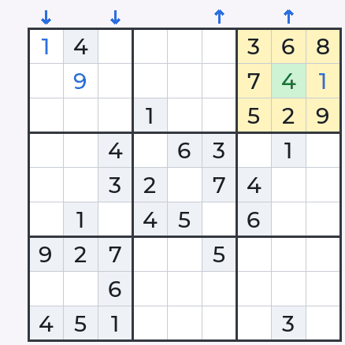

#### Step 5: the 9 in box 4

Box 4 needs a 9. r4c1, r5c1 and r6c1: column 1 has one (r7c1). r4c2 and r5c2: column 2 has one (r2c2). Only **r6c3** is left: **r6c3 = 9**.

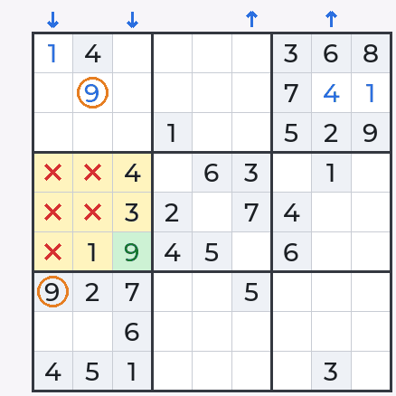

#### Step 6: the 1 in box 5

Box 5 needs a 1. r4c4: row 4 has one (r4c8). r6c6: row 6 has one (r6c2). Only **r5c5** is left: **r5c5 = 1**.

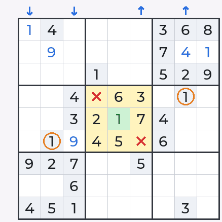

#### Step 7: the 9 in box 5

Box 5 needs a 9. r6c6: row 6 has one (r6c3). Only **r4c4** is left: **r4c4 = 9**.

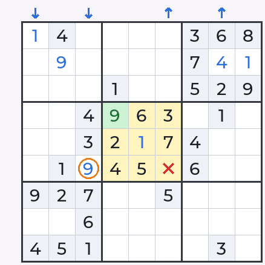

#### Step 8: the 8 in box 5

Box 5 needs an 8, and r6c6 is its last empty cell: **r6c6 = 8**.

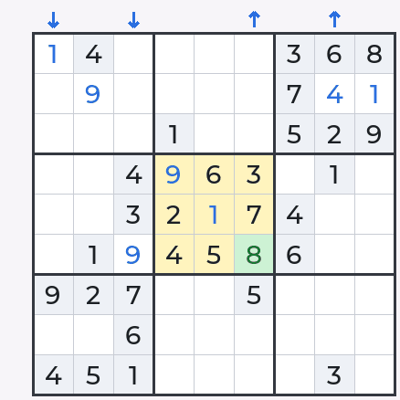

#### Step 9: the 3 in box 6

Box 6 needs a 3. r4c7 and r4c9: row 4 has one (r4c6). r5c8 and r5c9: row 5 has one (r5c3). r6c8: column 8 has one (r9c8). Only **r6c9** is left: **r6c9 = 3**.

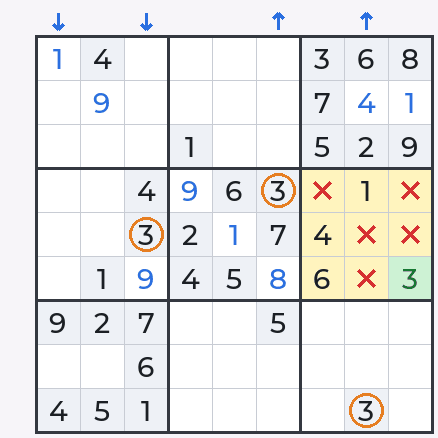

#### Step 10: the 9 in box 6

Box 6 needs a 9. r4c7 and r4c9: row 4 has one (r4c4). r5c9: column 9 has one (r3c9). r6c8: row 6 has one (r6c3). Only **r5c8** is left: **r5c8 = 9**.

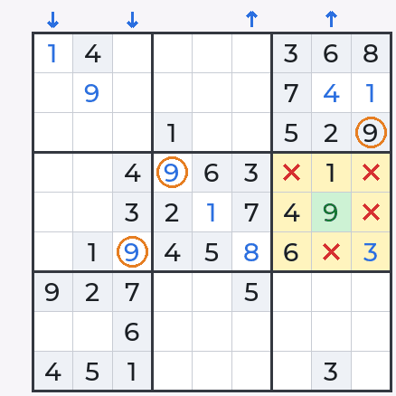

#### Step 11: the 8 in box 6

Box 6 needs an 8. r4c9 and r5c9: column 9 has one (r1c9). r6c8: row 6 has one (r6c6). Only **r4c7** is left: **r4c7 = 8**.

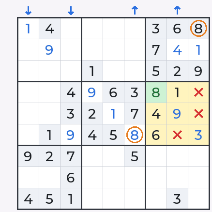

#### Step 12: the 8 in box 4

Box 4 needs an 8. r4c1 and r4c2: row 4 has one (r4c7). r6c1: row 6 has one (r6c6). r5c1: the first three digits of row 5 neither rise nor fall (row 5 has no arrow), and an 8 here can't keep that. Only **r5c2** is left: **r5c2 = 8**.

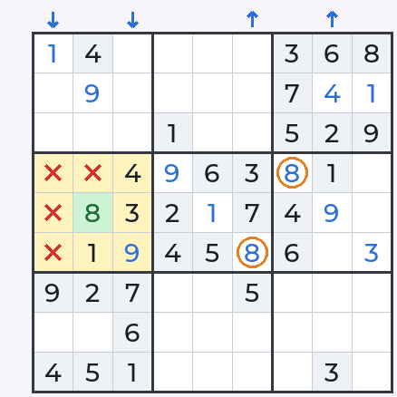

#### Step 13: the 6 in box 4

Box 4 needs a 6. r4c1 and r4c2: row 4 has one (r4c5). r6c1: row 6 has one (r6c7). Only **r5c1** is left: **r5c1 = 6**.

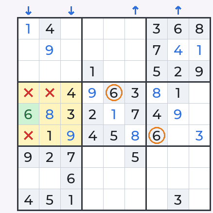

#### Step 14: the 6 in box 1

Box 1 needs a 6. r1c3: row 1 has one (r1c8). r2c1 and r3c1: column 1 has one (r5c1). r2c3 and r3c3: column 3 has one (r8c3). Only **r3c2** is left: **r3c2 = 6**.

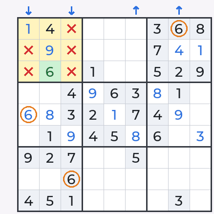

#### Step 15: the 7 in box 1

Box 1 needs a 7. r1c3 and r3c3: column 3 has one (r7c3). r2c1 and r2c3: row 2 has one (r2c7). Only **r3c1** is left: **r3c1 = 7**.

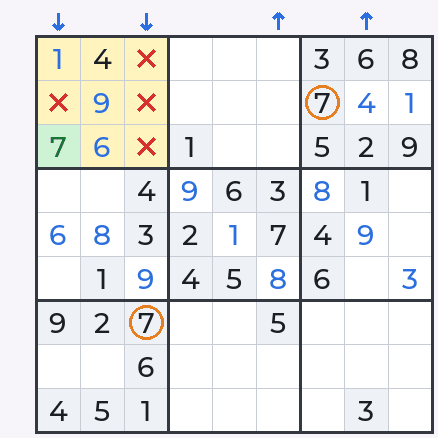

#### Step 16: the 3 in box 1

Box 1 needs a 3. r1c3: row 1 has one (r1c7). r2c3 and r3c3: column 3 has one (r5c3). Only **r2c1** is left: **r2c1 = 3**.

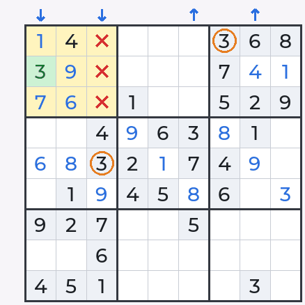

#### Step 17: the 2 in box 1

Box 1 needs a 2. r3c3: row 3 has one (r3c8). r2c3: the first three digits of column 3 rise from the top, and a 2 here can't keep that. Only **r1c3** is left: **r1c3 = 2**.

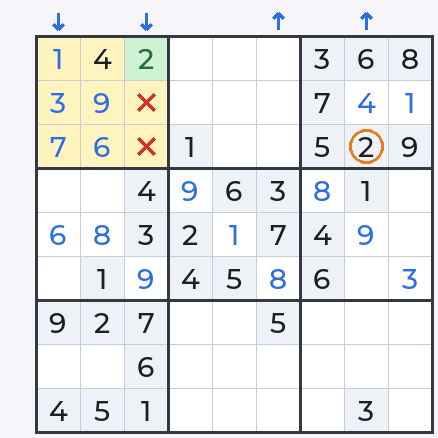

#### Step 18: the 5 in box 1

Box 1 needs a 5. r3c3: row 3 has one (r3c7). Only **r2c3** is left: **r2c3 = 5**.

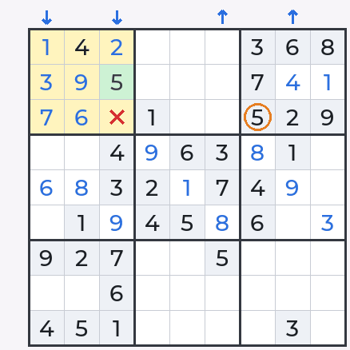

#### Step 19: the 8 in box 1

Box 1 needs an 8, and r3c3 is its last empty cell: **r3c3 = 8**.

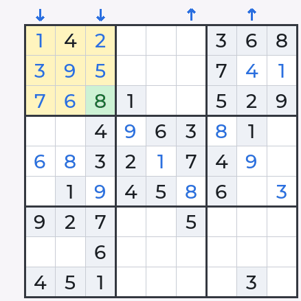

#### Step 20: the 3 in box 2

Box 2 needs a 3. r1c4, r1c5 and r1c6: row 1 has one (r1c7). r2c4, r2c5 and r2c6: row 2 has one (r2c1). r3c6: column 6 has one (r4c6). Only **r3c5** is left: **r3c5 = 3**.

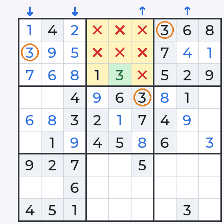

#### Step 21: the 4 in box 2

Box 2 needs a 4. r1c4, r1c5 and r1c6: row 1 has one (r1c2). r2c4, r2c5 and r2c6: row 2 has one (r2c8). Only **r3c6** is left: **r3c6 = 4**.

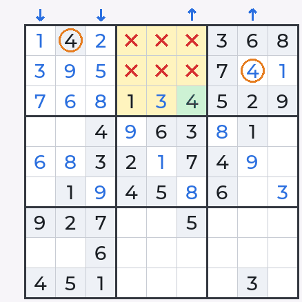

#### Step 22: the 2 in box 2

Box 2 needs a 2. r1c4, r1c5 and r1c6: row 1 has one (r1c3). r2c4: column 4 has one (r5c4). r2c6: the first three digits of column 6 fall from the top, and a 2 here can't keep that. Only **r2c5** is left: **r2c5 = 2**.

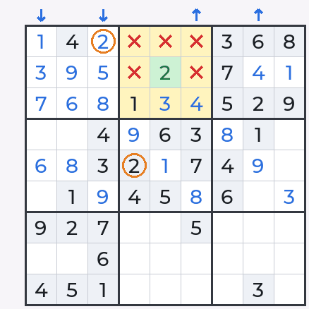

#### Step 23: the 5 in box 2

Box 2 needs a 5. r1c5: column 5 has one (r6c5). r1c6: column 6 has one (r7c6). r2c4 and r2c6: row 2 has one (r2c3). Only **r1c4** is left: **r1c4 = 5**.

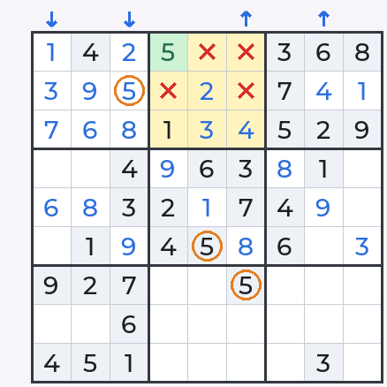

#### Step 24: the 7 in box 2

Box 2 needs a 7. r1c6: column 6 has one (r5c6). r2c4 and r2c6: row 2 has one (r2c7). Only **r1c5** is left: **r1c5 = 7**.

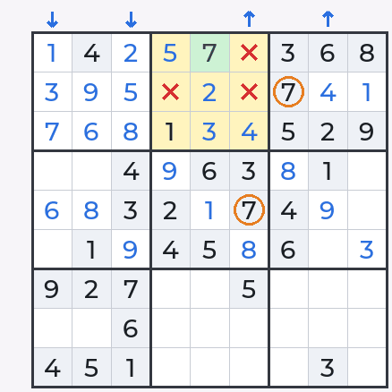

#### Step 25: the 8 in box 2

Box 2 needs an 8. r1c6: row 1 has one (r1c9). r2c6: column 6 has one (r6c6). Only **r2c4** is left: **r2c4 = 8**.

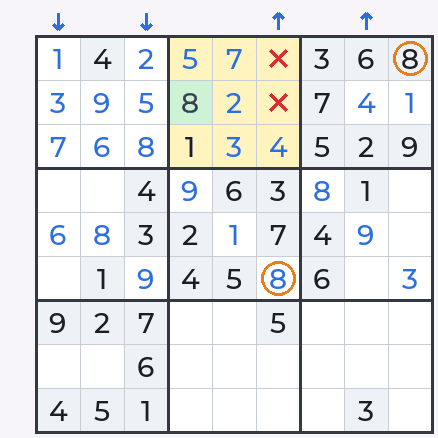

#### Step 26: the 6 in box 2

Box 2 needs a 6. r1c6: row 1 has one (r1c8). Only **r2c6** is left: **r2c6 = 6**.

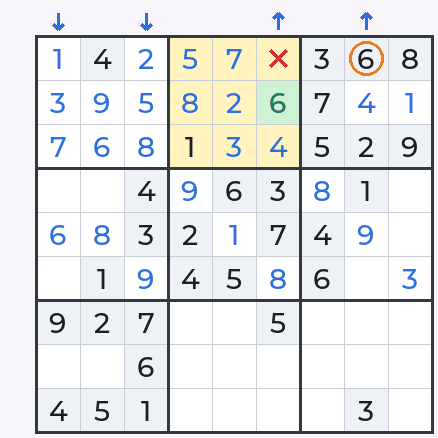

#### Step 27: the 9 in box 2

Box 2 needs a 9, and r1c6 is its last empty cell: **r1c6 = 9**.

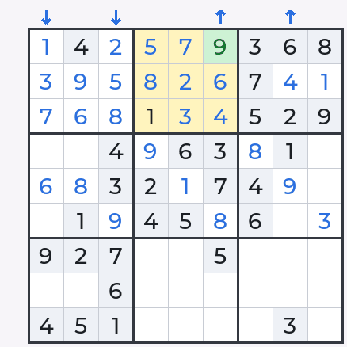

#### Step 28: the 5 in box 4

Box 4 needs a 5. r4c2: column 2 has one (r9c2). r6c1: row 6 has one (r6c5). Only **r4c1** is left: **r4c1 = 5**.

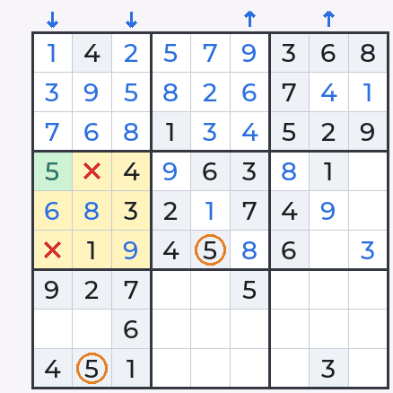

#### Step 29: the 2 in box 4

Box 4 needs a 2. r4c2: column 2 has one (r7c2). Only **r6c1** is left: **r6c1 = 2**.

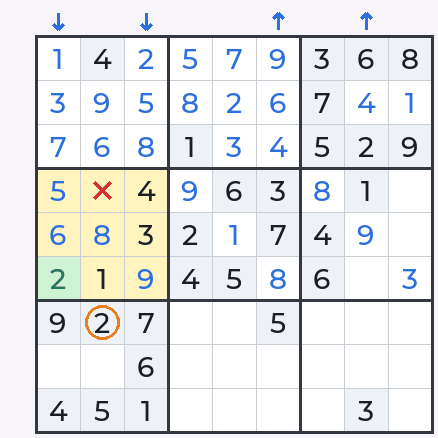

#### Step 30: the 7 in box 4

Box 4 needs a 7, and r4c2 is its last empty cell: **r4c2 = 7**.

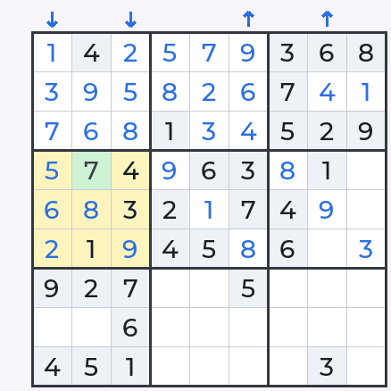

#### Step 31: the 2 in box 6

Box 6 needs a 2. r5c9: row 5 has one (r5c4). r6c8: row 6 has one (r6c1). Only **r4c9** is left: **r4c9 = 2**.

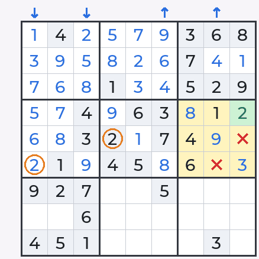

#### Step 32: the 5 in box 6

Box 6 needs a 5. r6c8: row 6 has one (r6c5). Only **r5c9** is left: **r5c9 = 5**.

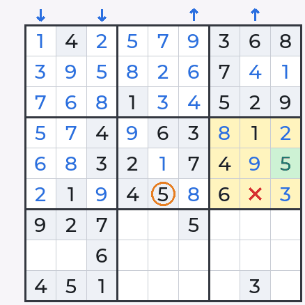

#### Step 33: the 7 in box 6

Box 6 needs a 7, and r6c8 is its last empty cell: **r6c8 = 7**.

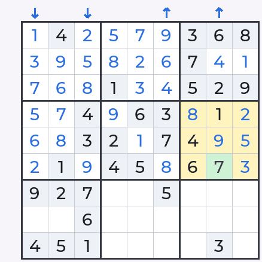

#### Step 34: the 3 in box 7

Box 7 needs a 3. r8c1: column 1 has one (r2c1). Only **r8c2** is left: **r8c2 = 3**.

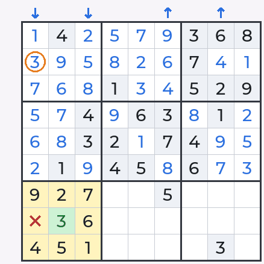

#### Step 35: the 8 in box 7

Box 7 needs an 8, and r8c1 is its last empty cell: **r8c1 = 8**.

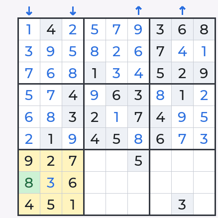

#### Step 36: the 1 in box 8

Box 8 needs a 1. r7c4 and r8c4: column 4 has one (r3c4). r7c5 and r8c5: column 5 has one (r5c5). r9c4, r9c5 and r9c6: row 9 has one (r9c3). Only **r8c6** is left: **r8c6 = 1**.

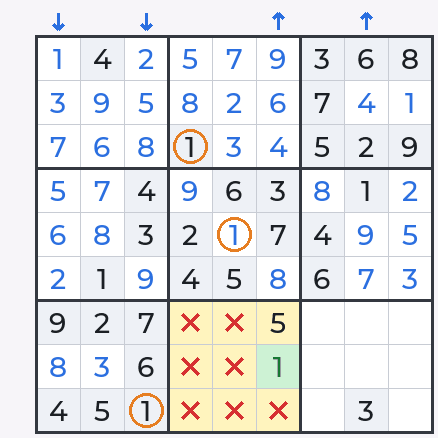

#### Step 37: the 2 in box 8

Box 8 needs a 2. r7c4 and r7c5: row 7 has one (r7c2). r8c4 and r9c4: column 4 has one (r5c4). r8c5 and r9c5: column 5 has one (r2c5). Only **r9c6** is left: **r9c6 = 2**.

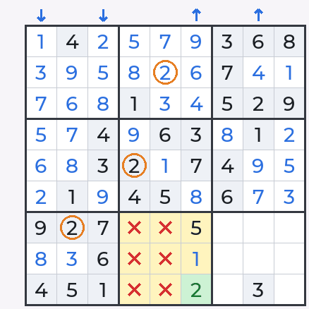

#### Step 38: the 3 in box 8

Box 8 needs a 3. r7c5: column 5 has one (r3c5). r8c4 and r8c5: row 8 has one (r8c2). r9c4 and r9c5: row 9 has one (r9c8). Only **r7c4** is left: **r7c4 = 3**.

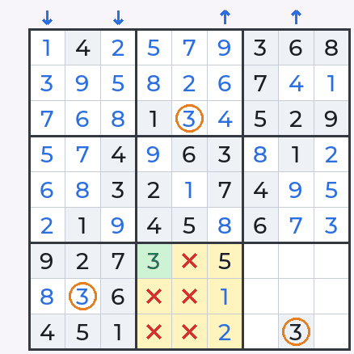

#### Step 39: the 6 in box 8

Box 8 needs a 6. r7c5 and r9c5: column 5 has one (r4c5). r8c4 and r8c5: row 8 has one (r8c3). Only **r9c4** is left: **r9c4 = 6**.

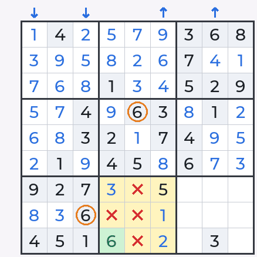

#### Step 40: the 7 in box 8

Box 8 needs a 7. r7c5: row 7 has one (r7c3). r8c5 and r9c5: column 5 has one (r1c5). Only **r8c4** is left: **r8c4 = 7**.

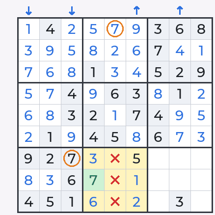

#### Step 41: the 1 in box 9

Box 9 needs a 1. r7c8: column 8 has one (r4c8). r7c9: column 9 has one (r2c9). r8c7, r8c8 and r8c9: row 8 has one (r8c6). r9c7 and r9c9: row 9 has one (r9c3). Only **r7c7** is left: **r7c7 = 1**.

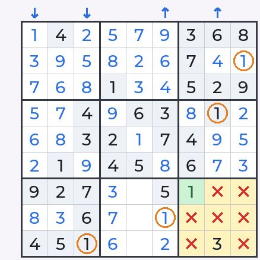

#### Step 42: the 2 in box 9

Box 9 needs a 2. r7c8 and r7c9: row 7 has one (r7c2). r8c8: column 8 has one (r3c8). r8c9: column 9 has one (r4c9). r9c7 and r9c9: row 9 has one (r9c6). Only **r8c7** is left: **r8c7 = 2**.

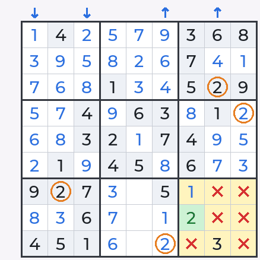

#### Step 43: the 5 in box 9

Box 9 needs a 5. r7c8 and r7c9: row 7 has one (r7c6). r8c9: column 9 has one (r5c9). r9c7 and r9c9: row 9 has one (r9c2). Only **r8c8** is left: **r8c8 = 5**.

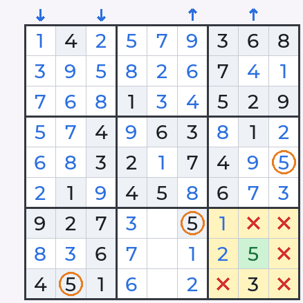

#### Step 44: the 6 in box 9

Box 9 needs a 6. r7c8: column 8 has one (r1c8). r8c9: row 8 has one (r8c3). r9c7 and r9c9: row 9 has one (r9c4). Only **r7c9** is left: **r7c9 = 6**.

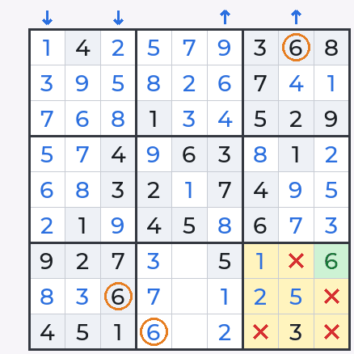

#### Step 45: the 4 in box 9

Box 9 needs a 4. r7c8: column 8 has one (r2c8). r9c7 and r9c9: row 9 has one (r9c1). Only **r8c9** is left: **r8c9 = 4**.

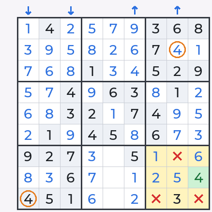

#### Step 46: the 4 in box 8

Box 8 needs a 4. r8c5: row 8 has one (r8c9). r9c5: row 9 has one (r9c1). Only **r7c5** is left: **r7c5 = 4**.

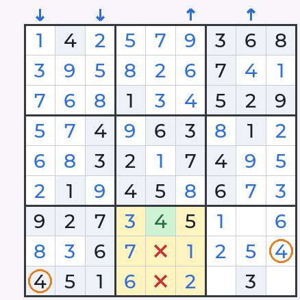

#### Step 47: the 8 in box 8

Box 8 needs an 8. r8c5: row 8 has one (r8c1). Only **r9c5** is left: **r9c5 = 8**.

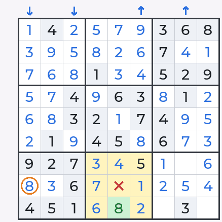

#### Step 48: the 9 in box 8

Box 8 needs a 9, and r8c5 is its last empty cell: **r8c5 = 9**.

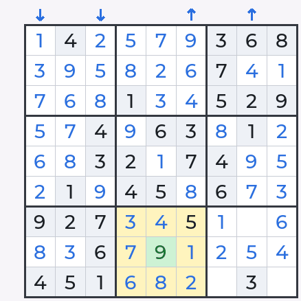

#### Step 49: the 7 in box 9

Box 9 needs a 7. r7c8: row 7 has one (r7c3). r9c7: column 7 has one (r2c7). Only **r9c9** is left: **r9c9 = 7**.

#### Step 50: the 8 in box 9

Box 9 needs an 8. r9c7: row 9 has one (r9c5). Only **r7c8** is left: **r7c8 = 8**.

#### Step 51: the 9 in box 9

Box 9 needs a 9, and r9c7 is its last empty cell: **r9c7 = 9**.

Solved.

<!-- /walkthrough -->
