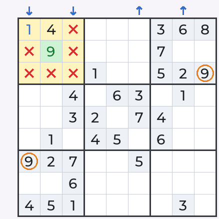

<!-- Written by tools/walkthrough.py rossini: edit the script, not this page. -->
# Rossini, step 2: the 9 in box 1

**Step 2 of 51** · [← Step 1](step-01.md) · [All steps](../rossini.md#the-whole-puzzle-step-by-step) · [Step 3 →](step-03.md)

Box 1 needs a 9. r2c1: column 1 has one (r7c1). r3c1, r3c2 and r3c3: row 3 has one (r3c9). r1c3: the first three digits of column 3 rise from the top, so its first cell is 1 to 7. r2c3: the first three digits of column 3 rise from the top, so its second cell is 2 to 8. Only **r2c2** is left: **r2c2 = 9**.

**Step 2 of 51** · [← Step 1](step-01.md) · [All steps](../rossini.md#the-whole-puzzle-step-by-step) · [Step 3 →](step-03.md)
