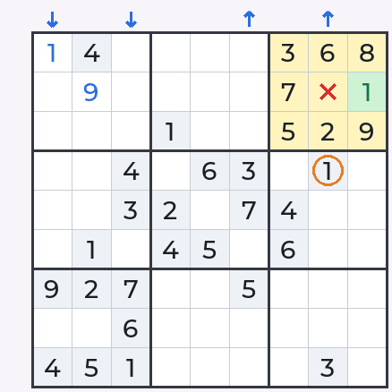

<!-- Written by tools/walkthrough.py rossini: edit the script, not this page. -->
# Rossini, step 3: the 1 in box 3

**Step 3 of 51** · [← Step 2](step-02.md) · [All steps](../rossini.md#the-whole-puzzle-step-by-step) · [Step 4 →](step-04.md)

Box 3 needs a 1. r2c8: column 8 has one (r4c8). Only **r2c9** is left: **r2c9 = 1**.

**Step 3 of 51** · [← Step 2](step-02.md) · [All steps](../rossini.md#the-whole-puzzle-step-by-step) · [Step 4 →](step-04.md)
