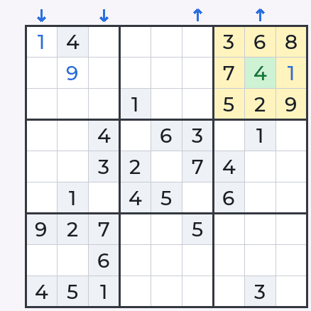

<!-- Written by tools/walkthrough.py rossini: edit the script, not this page. -->
# Rossini, step 4: the 4 in box 3

**Step 4 of 51** · [← Step 3](step-03.md) · [All steps](../rossini.md#the-whole-puzzle-step-by-step) · [Step 5 →](step-05.md)

Box 3 needs a 4, and r2c8 is its last empty cell: **r2c8 = 4**.

**Step 4 of 51** · [← Step 3](step-03.md) · [All steps](../rossini.md#the-whole-puzzle-step-by-step) · [Step 5 →](step-05.md)
