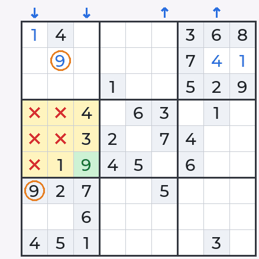

<!-- Written by tools/walkthrough.py rossini: edit the script, not this page. -->
# Rossini, step 5: the 9 in box 4

**Step 5 of 51** · [← Step 4](step-04.md) · [All steps](../rossini.md#the-whole-puzzle-step-by-step) · [Step 6 →](step-06.md)

Box 4 needs a 9. r4c1, r5c1 and r6c1: column 1 has one (r7c1). r4c2 and r5c2: column 2 has one (r2c2). Only **r6c3** is left: **r6c3 = 9**.

**Step 5 of 51** · [← Step 4](step-04.md) · [All steps](../rossini.md#the-whole-puzzle-step-by-step) · [Step 6 →](step-06.md)
