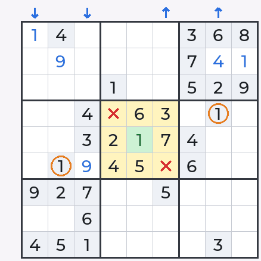

<!-- Written by tools/walkthrough.py rossini: edit the script, not this page. -->
# Rossini, step 6: the 1 in box 5

**Step 6 of 51** · [← Step 5](step-05.md) · [All steps](../rossini.md#the-whole-puzzle-step-by-step) · [Step 7 →](step-07.md)

Box 5 needs a 1. r4c4: row 4 has one (r4c8). r6c6: row 6 has one (r6c2). Only **r5c5** is left: **r5c5 = 1**.

**Step 6 of 51** · [← Step 5](step-05.md) · [All steps](../rossini.md#the-whole-puzzle-step-by-step) · [Step 7 →](step-07.md)
