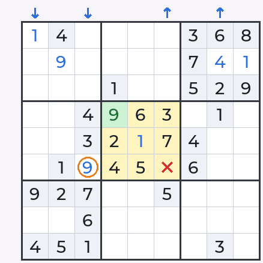

<!-- Written by tools/walkthrough.py rossini: edit the script, not this page. -->
# Rossini, step 7: the 9 in box 5

**Step 7 of 51** · [← Step 6](step-06.md) · [All steps](../rossini.md#the-whole-puzzle-step-by-step) · [Step 8 →](step-08.md)

Box 5 needs a 9. r6c6: row 6 has one (r6c3). Only **r4c4** is left: **r4c4 = 9**.

**Step 7 of 51** · [← Step 6](step-06.md) · [All steps](../rossini.md#the-whole-puzzle-step-by-step) · [Step 8 →](step-08.md)
