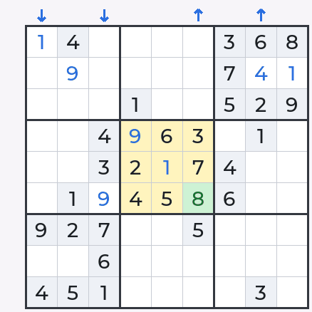

<!-- Written by tools/walkthrough.py rossini: edit the script, not this page. -->
# Rossini, step 8: the 8 in box 5

**Step 8 of 51** · [← Step 7](step-07.md) · [All steps](../rossini.md#the-whole-puzzle-step-by-step) · [Step 9 →](step-09.md)

Box 5 needs an 8, and r6c6 is its last empty cell: **r6c6 = 8**.

**Step 8 of 51** · [← Step 7](step-07.md) · [All steps](../rossini.md#the-whole-puzzle-step-by-step) · [Step 9 →](step-09.md)
