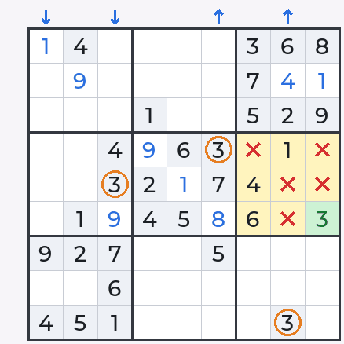

<!-- Written by tools/walkthrough.py rossini: edit the script, not this page. -->
# Rossini, step 9: the 3 in box 6

**Step 9 of 51** · [← Step 8](step-08.md) · [All steps](../rossini.md#the-whole-puzzle-step-by-step) · [Step 10 →](step-10.md)

Box 6 needs a 3. r4c7 and r4c9: row 4 has one (r4c6). r5c8 and r5c9: row 5 has one (r5c3). r6c8: column 8 has one (r9c8). Only **r6c9** is left: **r6c9 = 3**.

**Step 9 of 51** · [← Step 8](step-08.md) · [All steps](../rossini.md#the-whole-puzzle-step-by-step) · [Step 10 →](step-10.md)
