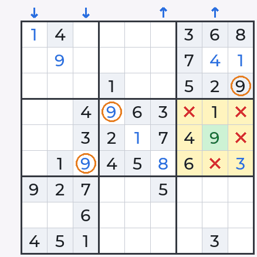

<!-- Written by tools/walkthrough.py rossini: edit the script, not this page. -->
# Rossini, step 10: the 9 in box 6

**Step 10 of 51** · [← Step 9](step-09.md) · [All steps](../rossini.md#the-whole-puzzle-step-by-step) · [Step 11 →](step-11.md)

Box 6 needs a 9. r4c7 and r4c9: row 4 has one (r4c4). r5c9: column 9 has one (r3c9). r6c8: row 6 has one (r6c3). Only **r5c8** is left: **r5c8 = 9**.

**Step 10 of 51** · [← Step 9](step-09.md) · [All steps](../rossini.md#the-whole-puzzle-step-by-step) · [Step 11 →](step-11.md)
